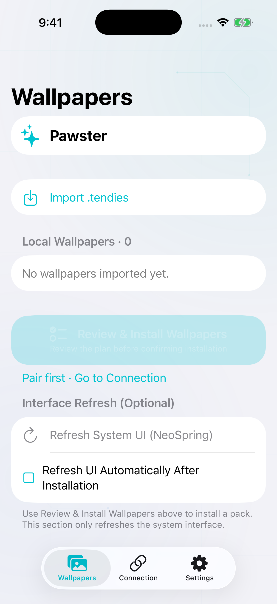
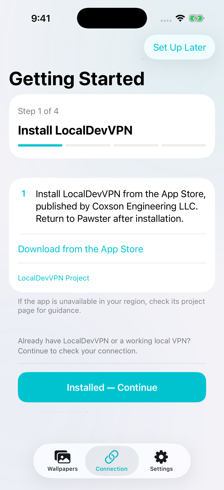
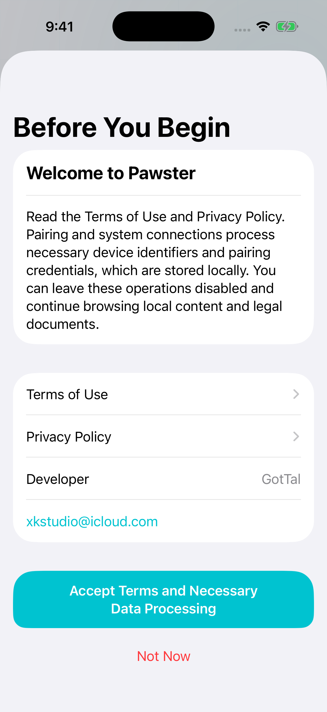

# Pawster 🐾

**English** · [简体中文](README_CN.md)

<p align="center">
  
</p>

<p align="center">
  <strong>Fresh wallpapers. A little feline charm.</strong><br />
  An on-device Collections wallpaper installer for iOS, built with SwiftUI and Rust.
</p>

<p align="center">
  <a href="https://github.com/GotTal/Pawster/actions/workflows/build.yml?query=branch%3Amain"></a>
  
  
  <a href="LICENSE"></a>
</p>

## Overview

Pawster helps you import Collections `.tendies` packs, check where they will go, and add them to the system wallpaper collection. Installation history keeps verification results and rollback actions close at hand—a little care with every pawprint.

Network-based paths use a local VPN to find the PosterBoard container through system services. File access uses `bad_query` or `worse_query`; AirTraffic and the older-system Pocket / Trash route are separate experimental transfers. Pocket manual UUID mode can work without pairing or a VPN.

> **Experimental software:** automated checks cover app logic and resources, but pairing, wallpaper visibility, and system UI refresh still need confirmation on real devices. Check the compatibility table before installing.

## A Peek Inside

<p align="center">
  
  
  
</p>

Wallpaper library · Getting Started · Welcome and privacy choices. Captured in a clean iOS simulator; device connection and wallpaper results depend on the compatibility below.

## Compatibility

Pawster currently enables the following wallpaper installation paths:

| iOS version | Access engine | Pairing |
| :--- | :--- | :--- |
| 17.0–18.7.2 | Experimental Pocket Poster / Trash | Manual UUID; pairing/VPN optional for discovery |
| 26.0–26.1 | `worse_query` default; `bad_query` or experimental Pocket / Trash | Imported file for discovery; manual UUID for Pocket |
| 26.1.1–26.6.1 | `worse_query` default; `bad_query` selectable | Imported file |
| 26.6.2–26.7.2 | `worse_query` | Imported file |
| 27.0 beta 4 (`24A5390f`) | `worse_query` default; `bad_query` or experimental AirTraffic | Native or imported |
| 27.0–27.0.1 | `worse_query` default; experimental AirTraffic selectable | Native or imported |
| 27.2 beta 1–2 (`24B5084k`, `24B5089g`) | `worse_query` default; experimental AirTraffic selectable | Native or imported |
| Other 27.0–27.2.1 builds | `worse_query` | Native or imported |
| 27.3 beta 1 (`24C5037i`) | `worse_query`; exact build required | Native or imported |
| Other versions | Installation unavailable | Pairing does not imply wallpaper support |

Pocket Poster / Trash extends the enabled source policy to iOS 17.0–18.7.2; it is also selectable on 26.0–26.1, where `worse_query` stays the default. These additions have passed native compilation and automated tests; real-device validation remains pending. Manual UUID mode needs no pairing or VPN, and reports a completed move request with an unverified target. See [Pocket Poster scope and setup](Docs/POCKET_POSTER.md).

Choose an available engine in **Connection → Paths & Compatibility**. Switching engines requires a new path check and plan. The choice is remembered for the current system build. See [compatibility sources and device reports](Docs/COMPATIBILITY.md) for the evidence and validation limits. AirCard’s AirTraffic wallpaper support is separate from these two file-access engines.

AirTraffic/Airlift is an experimental alternative that does not require an App Group, but needs Apple Books. It reports **sent, target unverified**, does not replace preferences or offer wallpaper rollback, and leaves refresh manual. Its known Tendies range is already covered by `worse_query`; it does not establish support for additional OS versions or iOS 18–26 wallpapers. See [AirTraffic details](Docs/AIRLIFT.md).

These paths are experimental, rather than a compatibility guarantee for every device. Support for one beta build does not extend to other builds with a similar version number.

Pawster currently handles **Collections wallpaper packs**. Other `.tendies` providers are not supported.

## Features

### Wallpapers, handled with care

- Import and preview Collections `.tendies` packs from Files.
- Review the destination and access engine before confirming an installation.
- Add new wallpaper descriptors while preserving existing descriptor directories.
- Verify written content and keep a record of each installation.
- Roll back an installation from its history entry. If its files have changed, Pawster stops the rollback for review.
- Swipe left to delete an imported pack from the local library.

### Pairing and local connections

- A first-use guide walks through LocalDevVPN, Developer Mode, and pairing, with progress saved across app launches.
- Import an existing pairing file or pair on the device on iOS 27.
- Follow a Picture in Picture guide with the live six-digit code while using Settings.
- View the local VPN route status, Iface IP, and Peer IP; set a peer override when needed.
- Replace or remove saved pairing credentials from the app.

### A calm home for your wallpapers

- Refresh the system interface manually with **NeoSpring**, or opt into automatic refresh after a verified installation.
- Switch between light, dark, and system appearance.
- Enjoy a subtle animated background, with an option to pause it.
- Use US English or Simplified Chinese. Available regional Chinese translations take precedence; otherwise Chinese falls back to Simplified Chinese. Other unavailable languages fall back to US English.

## Prerequisites

- An iPhone or iPad running a version listed in the compatibility table.
- A sideloading setup that preserves the app's required entitlements; the installation steps below use SideStore.
- [LocalDevVPN](https://apps.apple.com/app/id6755608044), or an equivalent route, for service-based discovery and injection. Pocket manual UUID mode does not require it.
- Developer Mode as required by your installation method. Pairing is required for service-based operations; Pocket manual UUID mode skips it.

Keep the device unlocked and the local VPN connected when pairing or accessing system wallpaper files.

## Installation

GotTal provides official Pawster builds free of charge, with no paid activation code, membership or feature unlock. If you paid another channel, ask the seller what the fee covers; official downloads remain free. Third-party services and redistribution retain their own applicable terms.

1. Download the IPA from **[the latest Release](https://github.com/GotTal/Pawster/releases/latest)**. Public Release assets do not require GitHub sign-in.
2. Verify the original download with the detached signature, public certificate, and SHA-256 manifest attached to the Release. See [file verification](Docs/VERIFYING_RELEASES.md) for commands and the pinned certificate fingerprint.
3. Add the IPA in SideStore and re-sign it with your own Apple ID.
4. Open **Pawster** and follow **Getting Started**. You can resume the guide from **Connection** or **Settings** at any time.

The release signature checks the downloaded file; it does not replace SideStore re-signing. Test and release builds share an app identifier, so installing one replaces the other. For future versions, check [the latest release](https://github.com/GotTal/Pawster/releases/latest).

## Pocket Poster Manual Setup

On a supported older system, Getting Started asks for this device’s PosterBoard UUID or container root. Paste it or import a small `NuggetPosterBoardHash` text file in Connection, then review the plan. Optional pairing-based discovery is available if you already have credentials and a local VPN. The existing Nugget Helper does not deliver files automatically to Pawster.

## Pairing Setup Guide

The built-in guide is the easiest place to start. These steps are also here when you need a quick reference.

### 1. Connect LocalDevVPN

Open LocalDevVPN, keep its default settings for a first setup, and tap **Connect**. Approve the VPN configuration when iOS asks, then return to Pawster. If you already have a working configuration, you can keep it.

In **Connection**, check the VPN status and addresses. With a custom configuration, Pawster's **Peer IP** should match LocalDevVPN's **Device IP**. A connected badge indicates a detected tunnel route; the subsequent path query checks the actual system connection.

### 2. Enable Developer Mode

Open **Settings → Privacy & Security → Developer Mode**, turn it on, and follow the restart prompt. After restarting, unlock the device and confirm **Enable** when asked. Reconnect LocalDevVPN before returning to Pawster. If Developer Mode is already enabled, continue to pairing.

If the option is missing, follow [Apple's Developer Mode guide](https://developer.apple.com/documentation/xcode/enabling-developer-mode-on-a-device). Pawster's **Open This App’s System Settings** button opens its own settings page; go back to the main Settings page to follow the path above.

### 3. Choose a pairing method

**On-device pairing — iOS 27**

1. In **Connection**, tap **Start On-device Pairing**, or **Pair Again** if a file is already saved.
2. Once the session starts, open **Settings → Privacy & Security → Developer Mode → Pair with Pawster**.
3. Enter the live six-digit code when it appears in the guide window or Pawster. Return to the app after pairing succeeds.

Allow local network access if prompted. If the guide window is unavailable, return to Pawster to view or copy the current code.

**Import an existing pairing file**

Tap **Import Pairing File**, or **Replace Pairing File**, and select your exported `.mobiledevicepairing` or `.plist` file. If you use SideStore, the file may be available at:

```text
Files → On My iPhone → SideStore → ALTPairingFile.mobiledevicepairing
```

Files exported from another pairing tool or computer can also be selected in Files. A ready file has passed local format checks; use the path query below to confirm that the device still accepts it.

## Installing a Wallpaper

For Pocket Poster manual UUID mode, follow the setup above; the network steps below apply to the other engines.

1. Keep the local VPN connected and the device unlocked.
2. In **Connection**, tap **Find Path**.
3. In **Wallpapers**, choose **Import .tendies**, then select a pack.
4. Tap **Review & Install Wallpapers**, check the plan, and choose **Confirm Injection**.
5. Open the system wallpaper picker to check the result and choose your wallpaper.

If the new wallpaper is not listed, open **Settings → Operation History** and use **Back Up and Refresh Registration** for the completed installation. **Refresh System UI (NeoSpring)** is a separate, optional action. It may briefly turn the screen black, return to the Lock Screen, or close the app; automatic refresh is off by default.

To undo an installation, use **Roll Back This Injection** in its history entry. Deleting an imported pack only removes Pawster's local copy; it does not remove the installed wallpaper or its history.

## Building from Source

### Requirements

- macOS and Xcode with the iOS 26 SDK or later. Apple silicon is recommended; the provided simulator build targets arm64.
- Rust stable and XcodeGen.

### Build current source

```bash
git clone https://github.com/GotTal/Pawster.git
cd Pawster
brew install xcodegen
bash Scripts/build-core.sh
PAWSTER_BUILD_CHANNEL=release bash Scripts/build-ipa.sh
```

The IPA is written to `build/Packages/`. The script applies an ad-hoc signature; re-sign the package with your sideloading setup before installing it.

### Run tests

```bash
python3 Scripts/check-localizations.py
cargo test --locked --manifest-path Core/Cargo.toml --features device
xcrun simctl list devices available
TEST_DESTINATION='platform=iOS Simulator,id=SIMULATOR_UDID' bash Scripts/test-macos.sh
```

Replace `SIMULATOR_UDID` with an available iOS 26-or-later simulator's identifier. Simulator tests cover app logic and resources; they do not establish real-device wallpaper compatibility.

Without a Mac, use the **Build and test Pawster** GitHub Actions workflow in your fork, selecting a branch containing the version you want to build. Successful runs attach an IPA artifact.

## Repository Structure

```text
Pawster/
├── App/                 SwiftUI app, setup guide, pairing, wallpapers, and settings
│   └── Resources/       App icon, language packs, and offline legal documents
├── Core/                Rust core, protocol bridges, and vendored dependencies
├── Tests/               Swift tests
├── Scripts/             Build, test, and resource-validation scripts
├── Docs/                Validation records and device checks
├── ThirdParty/          Source attributions and license notices
├── project.yml          XcodeGen project definition
├── LICENSE
├── README.md            English
└── README_CN.md         Simplified Chinese
```

## Help and Contributing

- New to Pawster? See the [setup FAQ](Docs/FAQ.md) and [device compatibility reports](Docs/COMPATIBILITY.md).
- Ready to lend a paw? Start with [Contributing](CONTRIBUTING.md), the [architecture](Docs/ARCHITECTURE.md) and [project priorities](Docs/ROADMAP.md).
- Report a [bug](https://github.com/GotTal/Pawster/issues/new?template=bug_report.yml), suggest a [feature](https://github.com/GotTal/Pawster/issues/new?template=feature_request.yml), or help with [localization](Docs/LOCALIZATION.md).
- Please follow the [community code of conduct](CODE_OF_CONDUCT.md). Report vulnerabilities privately using the [security policy](SECURITY.md).

## Credits

Pawster is developed by [GotTal](https://github.com/GotTal), with thanks to the projects and people whose work made these little paws possible:

| Project | Contribution |
| :--- | :--- |
| [AirCard-iOS](https://github.com/Mak5er/AirCard-iOS) | Pairing, local connection and container-query foundations, plus NeoSpring references |
| [worse_query](https://github.com/forcequitOS/worse_query) and [bad_query](https://github.com/forcequitOS/bad_query) | File-access engines |
| [idevice](https://github.com/jkcoxson/idevice) | Device protocols and connection support; vendored through the AirCard snapshot |
| [LocalDevVPN](https://github.com/jkcoxson/LocalDevVPN) | Local VPN tooling used during setup |
| [NeoSpring](https://github.com/rooootdev/neospring) | System UI refresh research; attribution includes @neonmodder123 and @skadz108 |
| [Erosion](https://github.com/jailbreakdotparty/Erosion) | PosterBoard investigation and design reference |

Pinned sources, modifications, and notices are listed in the [third-party source notes](App/Resources/Legal/ThirdPartySources.en-US.md).

## Support

- Report bugs or suggest improvements in [Issues](https://github.com/GotTal/Pawster/issues).
- Contact [GotTal](mailto:xkstudio@icloud.com) for private feedback or privacy-related questions.
- Help translate the app using the [localization guide](Docs/LOCALIZATION.md).

For bug reports, include your iOS version, Pawster build, and the error shown. Keep pairing files, live codes, and private wallpaper content out of public reports.

If Pawster earns a place on your phone, a Star is a lovely little treat. 🐟

## License and Privacy

Pawster's own code is licensed under **GPL-3.0-or-later**; see [LICENSE](LICENSE). Third-party components retain their original terms and notices. Some upstream licensing details remain unresolved; review the [source notes](App/Resources/Legal/ThirdPartySources.en-US.md) before redistributing a build. Wallpaper content retains its creators' rights and licenses.

The [Terms of Use](App/Resources/Legal/Terms.en-US.md) and [Privacy Policy](App/Resources/Legal/Privacy.en-US.md) are also available offline in Settings. The app has no developer-operated account service or analytics SDK; pairing credentials stay in its private storage, and in-app diagnostic logging is off by default. Connections go to the peer address you configure.

Pocket Poster-derived adapter files retain GPL v3 terms; see [the retained upstream license](ThirdParty/Pocket-Poster-GPL-3.0.txt) and [source notices](ThirdParty/SOURCES.md).
