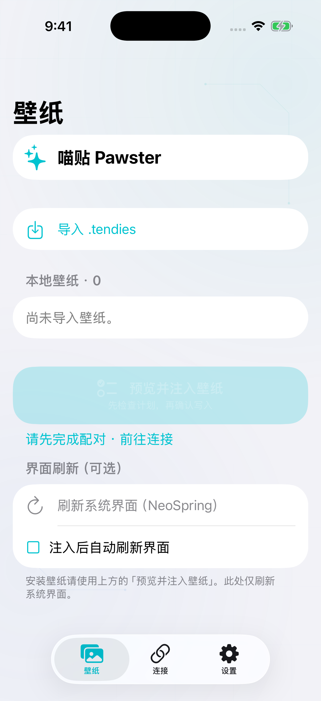
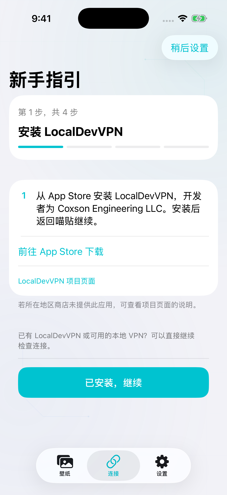
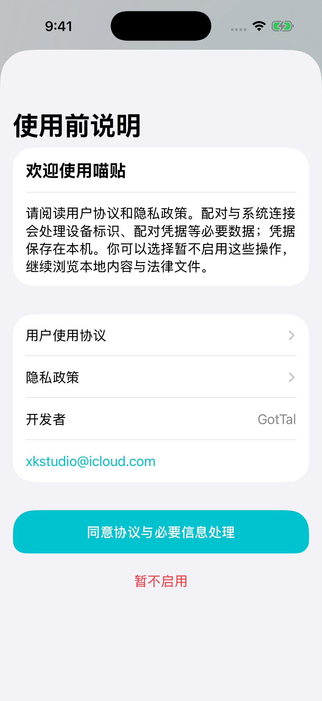

# 喵贴 Pawster 🐾

[English](README.md) · **简体中文**

<p align="center">
  
</p>

<p align="center">
  <strong>给锁屏换个心情，喵。</strong><br />
  使用 SwiftUI 与 Rust 构建的 iOS Collections 壁纸安装工具。
</p>

<p align="center">
  <a href="https://github.com/GotTal/Pawster/actions/workflows/build.yml?query=branch%3Amain"></a>
  
  
  <a href="LICENSE"></a>
</p>

## 简介

喵贴可以导入 Collections `.tendies` 壁纸包，预览安装目标，再将内容加入系统壁纸集合。每次安装都会留下校验结果和操作记录，方便查看与撤回——让每一步小爪印都有迹可循。

网络路径通过本地 VPN 连接系统服务查找 PosterBoard 容器，使用 `bad_query` 或 `worse_query` 访问文件；AirTraffic 和旧系统的 Pocket / Trash 是独立的实验性发送方式，后者填写 UUID 后可不依赖配对与 VPN。

> **目前为实验性软件：** 自动化检查覆盖应用逻辑与资源，但真实设备上的配对、壁纸显示和系统界面刷新仍需确认。安装前请先查看下方兼容性说明。

## 先看一眼，喵

<p align="center">
  
  
  
</p>

壁纸列表 · 新手指引 · 欢迎与隐私选择。截图来自干净的 iOS 模拟器，实际设备连接与壁纸效果以以下兼容性说明为准。

## 兼容性

当前版本启用以下壁纸安装路径：

| iOS 版本 | 访问引擎 | 配对方式 |
| :--- | :--- | :--- |
| 17.0–18.7.2 | 实验性 Pocket Poster / Trash | 手动 UUID；配对和 VPN 仅供可选查询 |
| 26.0–26.1 | 默认 `worse_query`，可选 `bad_query` 或实验性 Pocket / Trash | 查询需导入配对；Pocket 可手动 UUID |
| 26.1.1–26.6.1 | 默认 `worse_query`，可选 `bad_query` | 导入文件 |
| 26.6.2–26.7.2 | `worse_query` | 导入文件 |
| 27.0 beta 4（`24A5390f`） | 默认 `worse_query`，可选 `bad_query` 或实验性 AirTraffic | 本机或导入 |
| 27.0–27.0.1 | 默认 `worse_query`，可选实验性 AirTraffic | 本机或导入 |
| 27.2 beta 1–2（`24B5084k`、`24B5089g`） | 默认 `worse_query`，可选实验性 AirTraffic | 本机或导入 |
| 27.0–27.2.1 的其余构建 | `worse_query` | 本机或导入 |
| 27.3 beta 1（`24C5037i`） | `worse_query`，精确匹配构建号 | 本机或导入 |
| 其他版本 | 暂不可注入 | 能配对不代表能注入壁纸 |

Pocket Poster / Trash 将源码启用范围扩至 iOS 17.0–18.7.2；26.0–26.1 也可选择，默认仍为 `worse_query`。新增路径尚未完成喵贴的编译或实机验收。手动 UUID 不需要配对或 VPN，移动请求完成后仍标为目标未校验。详见 [Pocket Poster 范围与设置](Docs/POCKET_POSTER.md)。

可在**连接 → 路径与兼容性**中选择可用引擎；切换后需重新检查路径、生成计划，选择按当前系统构建号保存。来源及实测边界见[兼容性与实机反馈](Docs/COMPATIBILITY.md)。AirCard 使用的 AirTraffic 壁纸注入与这两个文件访问引擎分别判断。

AirTraffic/Airlift 是不依赖 App Group 的实验性替代方式，需要 Apple Books。发送结果标记为**已发送、目标未校验**，不覆盖偏好文件、不提供壁纸撤回，刷新需手动选择。其已知 Tendies 范围已被 `worse_query` 覆盖，不能据此宣称新增系统版本或支持 iOS 18–26 壁纸。详见 [AirTraffic 说明](Docs/AIRLIFT.md)。

这些是实验性访问路径，并非对所有设备的兼容性保证。某个 beta 构建适用，也不代表版本号相近的其他构建适用。

喵贴目前处理 **Collections 壁纸包**，暂不支持其他提供组件的 `.tendies` 内容。

## 功能

### 壁纸交给小爪子，细节留给你确认

- 从文件 App 导入并预览 Collections `.tendies` 壁纸包。
- 确认安装前，查看目标路径与访问引擎。
- 新增壁纸描述文件目录，保留原有描述文件目录。
- 校验写入内容，为每次安装保存操作记录。
- 从历史记录撤回安装；若相关文件已被修改，喵贴会停止撤回，留待检查。
- 在本地壁纸列表左划，删除导入的壁纸包副本。

### 配对与本地连接

- 首次使用指引带你完成 LocalDevVPN、开发者模式和配对，退出 App 后也会保存进度。
- 导入已有配对文件，或在 iOS 27 上完成本机配对。
- 前往系统设置时，通过画中画引导查看实时六位配对码。
- 查看本地 VPN 路由状态、Iface IP 和 Peer IP，按需设置覆盖对端地址。
- 在 App 中替换或移除已保存的配对凭据。

### 清清爽爽，安放喜欢的壁纸

- 手动使用 **NeoSpring** 刷新系统界面，也可选择在安装并校验成功后自动刷新。
- 跟随系统外观，或单独选择浅色、深色。
- 轻柔的薄荷色背景缓慢变化，可随时关闭动画。
- 支持简体中文与美式英语。中文优先使用已有地区或文字版本，未提供时回落简体中文；其他未提供的语言回落美式英语。

## 使用前准备

- 运行上表所列系统版本的 iPhone 或 iPad。
- 能保留 App 所需授权的侧载安装方式；下方安装步骤以 SideStore 为例。
- [LocalDevVPN](https://apps.apple.com/app/id6755608044)，或其他可用的本地 VPN 路由。
- 按安装方式完成开发者模式设置；网络操作需导入或创建配对文件，Pocket 手动 UUID 模式无需配对。

配对或访问系统壁纸文件时，请保持设备解锁、本地 VPN 已连接。

## 安装

喵贴由 GotTal 免费提供，官方版本无需购买激活码、会员或功能解锁。若你通过其他渠道付费取得 App，请向卖方核实收费内容；官方渠道仍可免费下载。第三方服务及再分发按各自适用条款处理。

1. 从 **[最新 Release](https://github.com/GotTal/Pawster/releases/latest)** 下载 IPA，公开发行附件无需登录 GitHub 即可下载。
2. 使用 Release 附带的分离签名、公钥证书和 SHA-256 清单核对原始文件；命令与固定证书指纹见[发布文件验签说明](Docs/VERIFYING_RELEASES.md#验签说明)。
3. 在 SideStore 中添加 IPA，使用自己的 Apple ID 重签安装。
4. 打开**喵贴**，按首次出现的**新手指引**完成设置。之后也可从**连接**或**设置**重新进入。

发布签名用于验证下载文件，不替代 SideStore 安装重签。测试版与正式版使用相同的应用标识，安装时会相互覆盖，不能并存。后续更新可前往[最新 Release](https://github.com/GotTal/Pawster/releases/latest)下载。

## Pocket Poster 手动设置

在支持的旧系统上，新手指引会请你填写本机 PosterBoard 容器 UUID 或根路径，也可在连接页导入较小的 `NuggetPosterBoardHash` 文本文件，再预览计划。已有配对文件与本地 VPN 时可选择自动查询；手动 UUID 不强制这些配置。现有 Nugget Helper 不会自动向喵贴传送文件。

## 配对设置指引

第一次使用，跟着 App 内的新手指引走就好；需要回头查看时，也可以参考下面的步骤。

### 1. 连接 LocalDevVPN

打开 LocalDevVPN，首次使用先保留默认配置，点击 **Connect／连接**。系统询问时允许添加 VPN 配置，再返回喵贴。已有可用配置时，可以继续使用。

在**连接**页查看 VPN 状态和地址。使用自定义配置时，喵贴的 **Peer IP** 应与 LocalDevVPN 的 **Device IP** 一致。已连接徽章表示检测到了隧道路由，后续的路径查询才会验证实际系统连接。

### 2. 开启开发者模式

前往**设置 → 隐私与安全性 → 开发者模式**，打开开关并按提示重启。重启解锁后，在系统确认弹窗中选择**开启**。再次连接 LocalDevVPN，再返回喵贴；若开发者模式此前已开启，可直接继续配对。

若找不到该选项，请参考 [Apple 官方开启说明](https://developer.apple.com/documentation/xcode/enabling-developer-mode-on-a-device)。喵贴中的**打开本 App 的系统设置**会进入自身设置页，请先返回设置首页，再按上述路径操作。

### 3. 选择配对方式

**本机配对——iOS 27**

1. 在**连接**页点击**开始本机配对**；已有配对文件时，按钮显示为**重新配对**。
2. 会话启动后，前往**设置 → 隐私与安全性 → 开发者模式 → 与 Pawster 配对**。
3. 六位配对码出现在引导小窗或喵贴中后，将其输入系统页面。配对成功后返回 App。

若系统询问本地网络访问，请选择允许。小窗不可用时，可回到喵贴查看或复制当前配对码。

**导入已有配对文件**

点击**导入配对文件**或**替换配对文件**，选择导出的 `.mobiledevicepairing` 或 `.plist` 文件。SideStore 用户可在以下位置查找：

```text
文件 → 我的 iPhone → SideStore → ALTPairingFile.mobiledevicepairing
```

其他配对工具或电脑导出的文件，也可以通过文件选择器导入。文件显示已就绪，表示本地格式检查通过；设备是否仍接受这些凭据，需要通过后续路径查询确认。

## 安装壁纸

Pocket Poster 手动 UUID 模式按上述设置即可；以下网络连接步骤适用于其他引擎。

1. 保持本地 VPN 连接，并解锁设备。
2. 在**连接**页点击**查询路径**。
3. 在**壁纸**页选择**导入 .tendies**，并选中壁纸包。
4. 点击**预览并注入壁纸**，检查计划后选择**确认注入**。
5. 前往系统壁纸选择界面，检查并选用新壁纸。

若新壁纸尚未出现在列表中，可进入**设置 → 操作记录**，对已完成的安装执行**备份并刷新注册**。**刷新系统界面（NeoSpring）**是另一个可选操作，可能短暂黑屏、返回锁屏或使 App 退出；自动刷新默认关闭。

需要撤回时，在对应记录中选择**撤回这次注入**。删除导入的壁纸包只会移除喵贴中的本地副本，不会移除已安装的系统壁纸或操作记录。

## 从源码构建

### 环境

- macOS，以及包含 iOS 26 或更新 SDK 的 Xcode。建议使用 Apple 芯片 Mac，当前模拟器构建目标为 arm64。
- Rust stable 与 XcodeGen。

### 构建当前源码

```bash
git clone https://github.com/GotTal/Pawster.git
cd Pawster
brew install xcodegen
bash Scripts/build-core.sh
PAWSTER_BUILD_CHANNEL=release bash Scripts/build-ipa.sh
```

IPA 输出至 `build/Packages/`。脚本使用 ad-hoc 签名，安装前仍需通过自己的侧载方式重签。

### 运行测试

```bash
python3 Scripts/check-localizations.py
cargo test --locked --manifest-path Core/Cargo.toml --features device
xcrun simctl list devices available
TEST_DESTINATION='platform=iOS Simulator,id=SIMULATOR_UDID' bash Scripts/test-macos.sh
```

将 `SIMULATOR_UDID` 替换为可用的 iOS 26 或更新模拟器标识。模拟器测试覆盖应用逻辑和资源，不能替代真实设备上的壁纸兼容性验证。

没有 Mac 时，可在自己的仓库副本中运行 **Build and test Pawster** GitHub Actions 工作流，选择包含所需版本的分支。成功运行后，可在构建产物中下载 IPA。

## 仓库结构

```text
Pawster/
├── App/                 SwiftUI 应用、首次指引、配对、壁纸与设置
│   └── Resources/       图标、语言包与离线法律文件
├── Core/                Rust 核心、协议桥接与第三方依赖快照
├── Tests/               Swift 测试
├── Scripts/             构建、测试与资源校验脚本
├── Docs/                验证记录与实机检查说明
├── ThirdParty/          来源署名与许可声明
├── project.yml          XcodeGen 项目定义
├── LICENSE
├── README.md            英文说明
└── README_CN.md         简体中文说明
```

## 使用帮助与参与贡献

- 第一次使用？查看[常见问题](Docs/FAQ.md)和[实机兼容性反馈](Docs/COMPATIBILITY.md)。
- 想来搭把小爪子？先看[贡献指南](CONTRIBUTING_CN.md)、[架构说明](Docs/ARCHITECTURE.md)与[项目方向](Docs/ROADMAP.md)。
- 可以反馈[错误](https://github.com/GotTal/Pawster/issues/new?template=bug_report.yml)、提出[功能建议](https://github.com/GotTal/Pawster/issues/new?template=feature_request.yml)，或参与[本地化](Docs/LOCALIZATION.md)。
- 参与时请遵守[社区行为准则](CODE_OF_CONDUCT.md)，安全问题通过[私密渠道](SECURITY.md)报告。

## 致谢

喵贴由 [GotTal](https://github.com/GotTal) 开发。感谢这些项目与贡献者，让小爪子有了探索的起点：

| 项目 | 相关贡献 |
| :--- | :--- |
| [AirCard-iOS](https://github.com/Mak5er/AirCard-iOS) | 配对、本地连接与容器查询基础，以及 NeoSpring 参考实现 |
| [worse_query](https://github.com/forcequitOS/worse_query) 与 [bad_query](https://github.com/forcequitOS/bad_query) | 文件访问引擎 |
| [idevice](https://github.com/jkcoxson/idevice) | 设备协议与连接支持，随 AirCard 快照引入 |
| [LocalDevVPN](https://github.com/jkcoxson/LocalDevVPN) | 设置过程中使用的本地 VPN 工具 |
| [NeoSpring](https://github.com/rooootdev/neospring) | 系统界面刷新研究；保留 @neonmodder123、@skadz108 的机制署名 |
| [Erosion](https://github.com/jailbreakdotparty/Erosion) | PosterBoard 排查与设计参考 |

固定来源、修改内容和许可声明见[第三方来源说明](ThirdParty/SOURCES.md)。

## 支持与反馈

- 在 [Issues](https://github.com/GotTal/Pawster/issues) 报告问题或提出建议。
- 需要私下沟通的问题或隐私相关事项，可[联系 GotTal](mailto:xkstudio@icloud.com)。
- 想为喵贴补充语言包？欢迎查看[本地化贡献规范](Docs/LOCALIZATION.md)。

反馈问题时，请附上 iOS 版本、喵贴构建号和错误提示。请勿在公开问题中附上配对文件、实时配对码或私人壁纸内容。

如果喵贴让你的锁屏多了一点快乐，欢迎点颗 Star，就当给小猫添一份小鱼干。🐟

## 许可证与隐私

喵贴自身代码采用 **GPL-3.0-or-later**，全文见 [LICENSE](LICENSE)。第三方组件保留原有许可与署名，部分上游授权信息仍待核实；再分发安装包前，请阅读[来源说明](ThirdParty/SOURCES.md)。壁纸内容的权利与许可仍属于其创作者。

[用户使用协议](App/Resources/Legal/Terms.md)与[隐私政策](App/Resources/Legal/Privacy.md)也可在 App 设置中离线查看。App 没有开发者账号后台或分析 SDK；配对凭据保存在自身私有目录，App 内诊断日志默认关闭，连接会发送至你配置的对端地址。

Pocket Poster 衍生适配文件保留 GPL v3 条款，见[上游许可全文](ThirdParty/Pocket-Poster-GPL-3.0.txt)及[来源声明](ThirdParty/SOURCES.md)。
